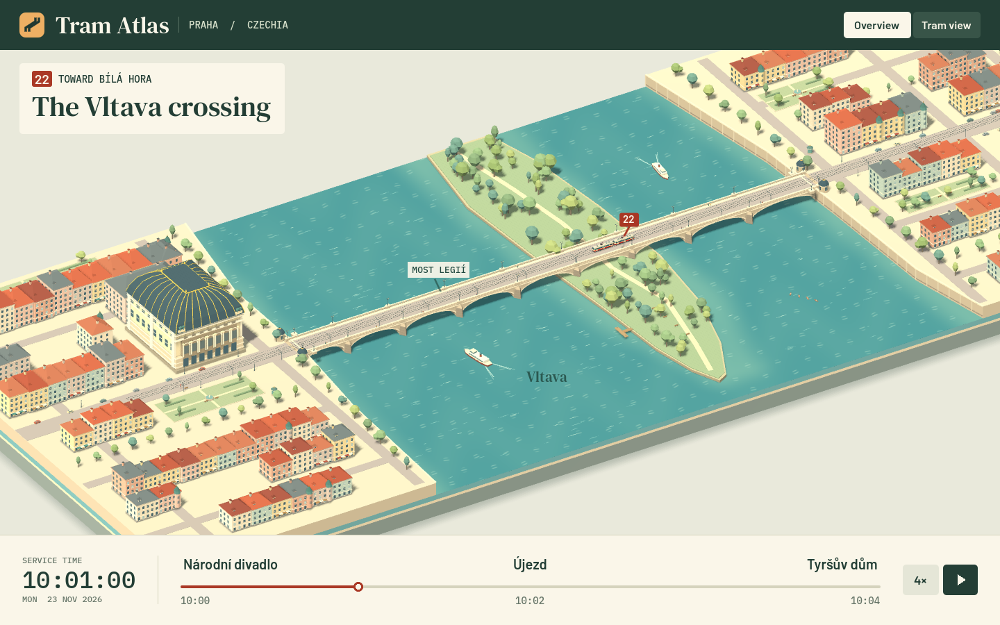

# Tram Atlas

Turn a local GTFS Schedule archive into a playable Godot scene. The included miniature follows Prague tram 22 across Most Legií, from the National Theatre to Tyršův dům. Built and tested with **Godot 4.6.1 Standard**, GDScript and the Compatibility renderer on Windows.

## Ride the Prague demo

On the prepared Windows machine, double-click **Run Prague.cmd**. On another machine, open `project.godot` with Godot 4.6.1 and press **F5**. The first editor import prepares the local fonts. All trip data and artwork are included.

Click a stop name to jump there, drag the timeline to scrub, or click **Tram view** to ride alongside the car. **Space** pauses, plays or replays. **S** cycles playback speed, **V** switches cameras, and the arrow keys step five timetable seconds. The crossing starts at 4× speed and pauses at its final stop.

| Service time, 23 Nov 2026 | Line 22 toward Bílá Hora | Metres along track |
| --- | --- | ---: |
| 10:00 | Národní divadlo | 0.0 |
| 10:02 | Újezd | 631.3 |
| 10:04 | Tyršův dům | 1,004.6 |

## Import your city

1. Extract [the standalone addon ZIP](dist/tram-atlas-addon.zip) at your project's root, or copy the entire `addons/tram_atlas` folder into the same location in your project. Enable **Tram Atlas** under **Project → Project Settings → Plugins**.
2. In the **Tram Atlas** editor dock, click **Select GTFS ZIP…** and choose a local GTFS Schedule file. The suggested service date can be changed with **Apply**. Search the route list by line name, number or ID.
3. Select a route, direction or destination, and trip. The trip selector includes the departure from the trip's first stop and its ID. Choose the first and last stops of the stretch you want.
4. Click **Generate route scene…** and save a `.tscn` inside your project. Godot opens it. Press **F6** to play. You can instance this saved scene in another scene or choose it as your project's main scene.

To recreate the demo selection offline, open `demo/data/prague-22.zip`, use **2026-11-23**, route **22**, **Bílá Hora · 1**, and trip **09:25:00 · 22_33955_260831**. Select stops **27 · Národní divadlo** through **29 · Tyršův dům**. The ZIP retains all 45 calls of this trip.

## Edit the route or replace the vehicle

The generated tree has an editable **Track** (`Path3D`), **Track/Vehicle** (`PathFollow3D`) and a **Stops** group of named `Marker3D` nodes. Select the scene root and drop your tram's `PackedScene` into **Presentation → Vehicle Scene**. Use a `Node3D` root with its origin at rail height, +Y up and −Z forward. Save the scene and press F6.

**Preview Enabled** provides neutral track, a following camera, lighting and playback controls. Disable it when supplying your own surroundings and UI. The Prague wrapper does this and supplies its own Tatra model. The route remains playable with the original ZIP disconnected. If you change the path length manually, update the root's metre offsets in **Timetable → Distances** and reposition the stop markers.

## Timetable model and limits

- Calendar weekdays, date ranges and `calendar_dates.txt` exceptions resolve trips on a **service date**. Times such as `24:15:00` stay on that service day's clock. At a stop the tram waits from arrival through departure. It then travels at constant speed by track distance to the next arrival.
- Published shape vertices are retained between the selected endpoints. The importer uses compatible GTFS distance values, or matches platforms to the shape in order. The local plane is east +X, north −Z, with one unit per metre. This approximation is intended for local stretches. Elevation, actual traffic, acceleration and realtime delays are outside the timetable model.
- A generated stretch needs a usable published shape and timed calls. The dock explains missing geometry, incomplete times and frequency-based trip templates. It does not expand headways into individual departures. The 3D preview assumes rail vehicles and a flat route.

## Data, license and verification

Code and original artwork are MIT-licensed. The bundled PID timetable excerpt and derived route geometry use CC BY 4.0. Font license notices are in `demo/type`. [PID attribution and archive identity](demo/data/ATTRIBUTION.md) · [MIT license](LICENSE) · [Test results and reproduction](docs/verification.md)
